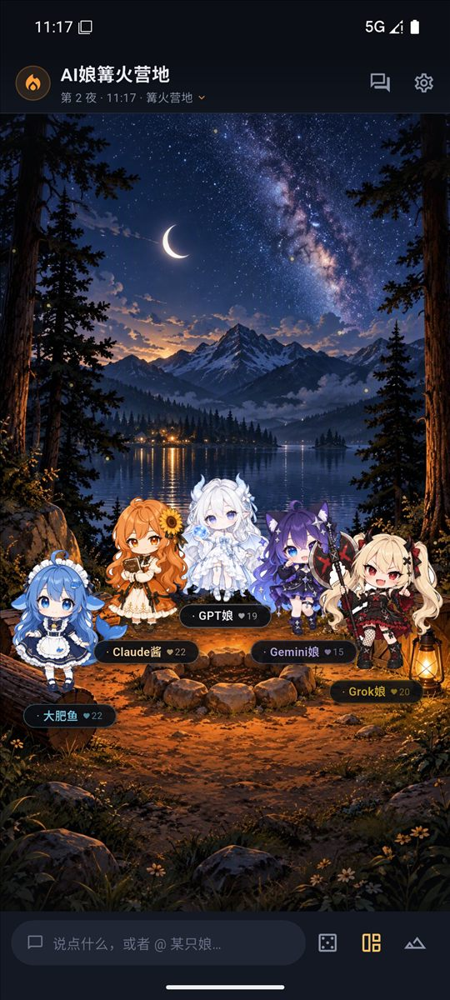
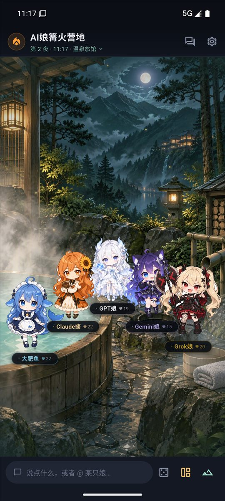
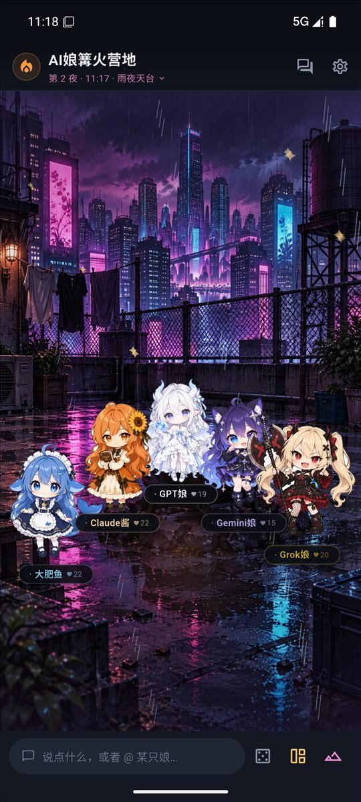
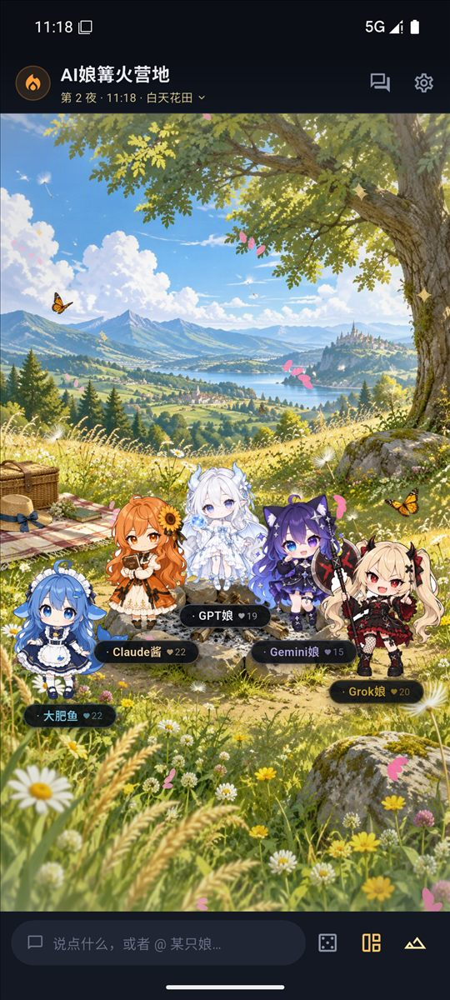
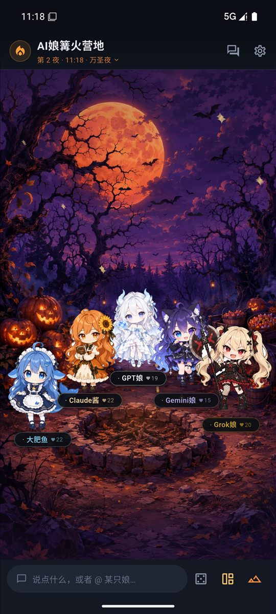
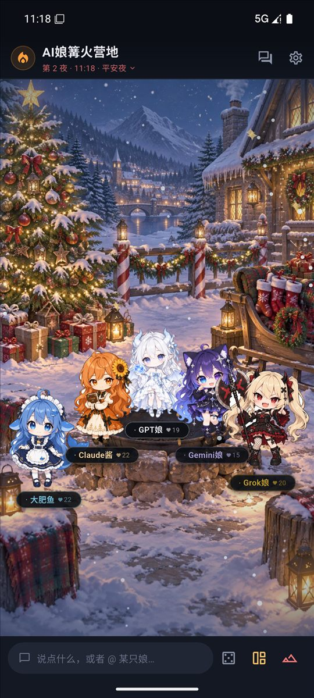

# AI娘篝火营地 · AiPet

> 五个有脾气、有记忆、会互怼的 AI 娘，住在你手机的篝火营地里。
> Flutter 编写的 Android 应用 · 个人非商业项目 · v0.9.0

她们不是五个客服对话框，而是**住在同一个群里的人**：@ 点名会答，没人理也会自己聊起来；你戳她一下她会记仇，投喂对了东西会开心一整天；你说过的“我叫什么 / 我喜欢什么 / 她答应了什么”会被记进记忆册。换到雪夜场景，她会抬头说“下雪了”——因为场景真的会写进她的提示词。

## 截图

篝火营地 | 温泉旅馆 | 雨夜天台
---|---|---
 |  | 

白天花田（不点火、白天光照） | 万圣夜（蝙蝠） | 平安夜
---|---|---
 |  | 

> 截图为模拟器实机截图，五个人站在各自场景的预留空地上——v0.8 起每个场景一张独立背景，不再靠滤镜区分。

## 下载体验

[**Releases → aining-campfire-v0.9.0-release.apk**](https://github.com/MrXyu1453/AiPet/releases/tag/v0.9.0)（约 92 MB，Android 8.0+，arm64 / x86_64 可直接侧载）。安装后在**设置页填入任意 OpenAI 兼容 API Key**（默认预设 DeepSeek）即可解锁真实对话；不填 Key 也有完整可玩的**试玩模式**（本地台词 + 全部互动系统）。

## 玩法

| 玩法 | 说明 |
|---|---|
| 💬 **娘际群聊** | 五娘同群互聊：本地导演调度谁接话、谁吃醋、谁捣乱；流式输出、串行队列不抢话；引用回复、@ 芯片 |
| 🏕️ **14 个场景** | 篝火营地 / 雪夜松林 / 春夜庭院 / 黄昏湖岸 / 雨夜檐下 / 极光冰湖 / 星灯祭典 / 温泉旅馆 / 雨夜天台 / 秋日枫林 / 白天花田 / 月光海滩 / 万圣夜 / 平安夜。每个场景独立背景 + 天气粒子（雪/雨/樱/萤火/天灯/蒸汽/落叶/气泡/蝙蝠），**并且会注入提示词——她们真的“看见”了** |
| 🫵 **戳一戳 / 摸头** | 分区触摸反应（头/脸/身体/尾巴），心情系统 14 分钟半衰期，会记仇也会脸红 |
| 🍙 **投喂** | 8 种道具，每人有喜好和雷点，送对触发专属反应 |
| 🎤 **演唱会 + 节奏挑战** | 纯 Dart 运行时合成 BGM（无版权音频），主唱轮唱，5 轨点按小游戏，结束后她真的会吐槽你 0 分 |
| 🎲 **篝火事件** | 每天一个随机事件（流星 / 湿柴 / 停电 / 偷饭团…），你的选择影响心情和好感 |
| 💞 **真心话 / 大冒险** | 24 + 12 张问题卡，可点名任何人 |
| 🕯️ **私聊** | 一对一独立历史、独立好感、更私密的话题；大肥鱼有 Live2D 全身模型 |
| 🧠 **记忆册** | 轻量抽取“我叫 / 我喜欢 / 我答应”，长按消息收藏；好感分 5 档（初见→心意相通） |
| 🎭 **角色二创** | 给她补人设 / 关系 / 小秘密 / 专属称呼 / 声线，导出 **SillyTavern Character Card V2** 兼容角色卡，也可导入 |
| 📸 **合影** | 把整个舞台（含字幕）截成 PNG 保存 |
| 🌗 **光线随时间** | 破晓 / 黄昏 / 深夜会叠一层很淡的时间色，凌晨她们真的困 |

## 活人感是怎么来的

- **人设**：性格、说话方式、关系网（对另外四人各有一句具体关系）、口头禅、**不会主动说出口的小秘密**（被戳中会露出破绽）。
- **状态注入**：每次生成时把【营地状态】（时间/心情/好感/记忆）+【眼前】（场景描述）+【导演提示】拼进 system 提示词，见 `lib/core/prompts.dart`。
- **本地导演**：`lib/core/director.dart` 决定谁回复谁沉默——被 @ 必应，吵架现场会插话，被冷落会接不到话。
- 架构细节见 [docs/ARCHITECTURE.md](docs/ARCHITECTURE.md)，完整版本史见 [CHANGELOG.md](CHANGELOG.md)。

## 素材来源与授权（重点）

本项目**不使用任何原创美术**，全部素材来源如下：

### 角色立绘 / 头像 / Q版
- **ZipZipPipe（胖次狐）** 的 AI 娘官方感全身立绘：B 站 [space.bilibili.com/4168597](https://space.bilibili.com/4168597)。经「蓝色大肥鱼」AI娘二创开放档案站获取（预览原图规律：`/submissions/previews/` → `/submissions/large/`）。
- **蓝色大肥鱼档案站**：https://xn--pssy23gqgbz2d718b.com/ （punycode，即「蓝色大肥鱼.com」，源码 [lmy414/bluedafeiyu](https://github.com/lmy414/bluedafeiyu)），ZipZipPipe 合集页 `/topics/zipzippipe.html`。
- 图片版权归原作者，档案站标注多为**授权未明 / 非商业**；本项目为个人学习用途的非商业开源演示，**如需商用请先逐张取得画师授权，或替换为自己的资产**。
- 角色形象的文化源头：AI 娘二创社区（大肥鱼/鲸鱼娘、Claude酱、GPT娘、Gemini娘、Grok娘），设定参考 [Neko3000/deepseek-whalechan](https://github.com/Neko3000/deepseek-whalechan)（MIT + 图片 CC-BY-NC-SA）。

### Live2D
- 大肥鱼私聊模型：公开分发的蓝色鲸鱼女仆 Cubism 公皮（`lrplrplrp/dsh-live2d` 内置），权利归原作者，仅限非商业。
- Live2D Cubism SDK 归 Live2D Inc. 所有，遵守其[软件许可](https://www.live2d.com/eula/live2d-proprietary-software-license-agreement_cn.html)。
- `packages/flutter_live2d` 是 [flutter_live2d 1.0.2](https://pub.dev/packages/flutter_live2d) 的本地 fork（触摸不消费 + shader 懒编译，见 `packages/flutter_live2d/PATCH.md`）。

### 场景背景图（v0.8 起 14 张独立背景）
- `assets/bg/<id>.jpg` 全部由 **AI 图像生成**产出（统一构图：下方留人物空地、中央未点燃火塘），无第三方画师素材。

### 音频
- BGM、篝火环境音、所有音效均为 `lib/core/audio_synth.dart` **运行时程序化合成**的 WAV，零音频素材、零版权风险。
- TTS 使用设备系统中文语音引擎（`flutter_tts`）。

### 表情包
- 社区流传的 AI 娘梗图（去白底压缩后使用），原始出处多为档案站 `/categories/meme.html` 收录的二创，同样仅限非商业。

> **侵权请联系即删**：本项目不主张对上述立绘/模型素材的任何权利，如原作者要求，提交 issue 我们会立刻替换或下架。

## 开发构建

```bash
# 依赖：Flutter 3.47+ · JDK 17 · Android SDK（含 CMake 3.22.1）
flutter pub get
flutter analyze          # 当前 No issues found
flutter test             # 32 个测试
flutter build apk --debug
```

- 若网络环境无法从 `services.gradle.org` 下载 Gradle 分发，可下载 `gradle-9.3.1-all.zip` 后把 `android/gradle/wrapper/gradle-wrapper.properties` 的 `distributionUrl` 改成本地 `file:///` 路径。
- `android/local.properties` 里的 `flutter.sdk` / `sdk.dir` 是本机路径，clone 后按自己环境修改。
- NDK 由 Gradle 自动拉取；release APK 约 90 MB（Live2D 纹理 + 14 张背景）。

### 目录速览

```
lib/
  core/        # API 客户端、提示词、导演调度、场景定义、情绪/好感/记忆、音频合成
  data/        # 五人人设、二创角色卡、事件/道具表
  state/       # 群聊/私聊控制器、设置
  features/    # 营地舞台、聊天、场景面板、设定编辑器、私聊、资料卡、设置
assets/
  bg/          # 14 张场景背景（AI 生成）
  sprites/     # 立绘（官方全身 f0.png + Q版 chibi.png，顶栏一键切换）
  live2d/      # 大肥鱼 Cubism 模型
docs/          # ARCHITECTURE.md（分层/数据流/性能约束）、REFERENCES.md、char_*.md（五人人设档案）
tool/          # 立绘与背景处理脚本（抠图/切帧/PNG→JPEG/缩放）
```

## 已知边界

- API Key 存 SharedPreferences（本机明文）——个人项目可接受，公开分发建议换 `flutter_secure_storage`。
- 立绘素材授权未明，**不要商用、不要二次分发素材包**；代码本身随便看随便玩。
- 更多技术债与坑（布局断言吞立绘、键盘双重 padding、Cubism JSON 怪癖等）写在 README 历史版本与 `docs/ARCHITECTURE.md`。

## License

本项目**代码**采用 [MIT](LICENSE)；`assets/` 下的立绘、头像、Live2D 模型等第三方素材**不随 MIT 授权**，版权归各自原作者，仅限非商业学习用途。
